# Screen implementation reference

This document describes the 11 routed components under `src/screens/`. It reflects the current implementation rather than intended or planned functionality. The application splash (`src/app/MileVDoSplash.tsx`) is a temporary overlay mounted by the root `App.tsx`, not a navigation screen, so it is not included as a routed screen.

## Application-wide behavior

- `App.tsx` provides one TanStack Query client (query retry: once; default stale time: 15 seconds), the safe-area context, and the navigation container via `AppNavigator`.
- The bottom tabs are Home, Camera, Videos, Trips, and Settings; Camera is the initial tab. The stack also declares VideoPlayback, StorageManager, CloudProviders, CameraSettings, PrivacySettings, and Diagnostics.
- There are no HTTP, REST, or GraphQL calls in these screens. "API" below refers to local SQLite, device filesystem, React Native permission/location/camera APIs, native modules, the share sheet, and AsyncStorage.
- Data shown by `useQuery` is loaded from local SQLite or device storage. Recordings and trips are persisted in SQLite; recording media is kept in the app documents directory. Camera settings and playback resume positions use AsyncStorage.
- Common visual structure is supplied by [`Screen`](../src/components/Screen.tsx) and [`Card`](../src/components/Screen.tsx). Common controls include [`ActionButton`](../src/components/UI.tsx), [`Label`](../src/components/UI.tsx), [`Row`](../src/components/UI.tsx), [`Metric`](../src/components/UI.tsx), and [`StatusBadge`](../src/components/UI.tsx).

## 1. Dashboard — Home

**Screen name and file:** Dashboard (Home tab), [`DashboardScreen.tsx`](../src/screens/DashboardScreen.tsx).

**Purpose and layout:** Shows recording status and elapsed time, selected camera, available device storage, trip tracking state, and up to three recent finalized clips. Hierarchy: `Screen` heading/subtitle → status `Card` with badge and two metric rows → primary camera action → recent-clips heading/link → loading, error, empty, or recent-clip cards → platform-specific recording note.

**Inputs and validation:** No user-entered fields. No validation.

**Buttons and interactions:** “Start a recording” or “Open recording controls” navigates to the Camera tab. “View all” navigates to Videos. Recent clips are display-only and are not individually tappable here.

**API calls and request/response handling:** `useQuery(['recordings'], listRecordings)` reads recordings ordered newest-first from SQLite; only the first three are displayed. `useQuery(['storage'], RNFS.getFSInfo)` reads filesystem free space, with a 30-second stale time. There are no remote requests. Recording-query loading renders an activity indicator, errors render the error message, and an empty array renders “No clips yet.” Storage loading is represented as an em dash; a storage failure changes the metric detail to “Storage check unavailable.”

**State management:** Reads recording status/elapsed seconds from `useRecordingStore`, camera choice and settings from `useSettingsStore`, and current trip-tracking flag from `useTripStore`. Recording and storage query results are TanStack Query state. `formatDuration` and `formatClipDate` are local formatting helpers.

**Navigation and parameters:** Home has no parameters. Navigates to Camera and Videos. No route parameters are read.

**Other states:** Status badge shows RECORDING only for `status === 'recording'`; other statuses show STANDBY. An error state has a separate message directing the user to Camera. Recent clips have loading, query error, empty, and populated states. Storage errors are displayed inline in the metric detail.

**Reusable components and related code:** `Screen`, `Card`, `ActionButton`, `Label`, `Metric`, `StatusBadge`; `listRecordings`, `formatBytes`, `formatDuration`; recording/settings/trip Zustand stores; `RNFS.getFSInfo`.

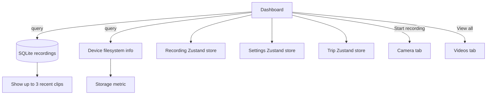

**Source references:** [`DashboardScreen.tsx`](../src/screens/DashboardScreen.tsx), [`database.ts`](../src/data/database.ts), [`recordingStore.ts`](../src/features/recording/recordingStore.ts), [`settingsStore.ts`](../src/features/recording/settingsStore.ts), [`tripStore.ts`](../src/features/trips/tripStore.ts), [`formatBytes.ts`](../src/features/storage/formatBytes.ts), [`AppNavigator.tsx`](../src/navigation/AppNavigator.tsx).

## 2. Recording — Camera

**Screen name and file:** Recording (Camera tab), [`RecordingScreen.tsx`](../src/screens/RecordingScreen.tsx).

**Purpose and layout:** Full-screen camera preview and recording controls. It supports a selected single camera and, when the Android device reports a compatible pair, optional simultaneous front/rear capture. Overlays show heading/clock/date/GPS speed, AI detection status/boxes, microphone and camera capability status, recording errors, controls, and elapsed time. The preview conditionally renders one or two Vision Camera components; the camera overlay sits on top.

**Inputs and validation:** No text inputs. Start is guarded by camera permission, selected device/format availability, optional microphone permission, and—when dual mode is selected—concurrent-camera capability and both devices/formats being ready. Before each segment it checks free space: below 512 MB, recording is blocked; when loop cleanup is enabled it first tries to remove eligible clips toward a 1 GB free-space target, then rechecks. GPS samples are accepted only with finite coordinates/timestamp and valid accuracy; speed uses provider speed only when it passes range/accuracy checks, otherwise an estimate may be attempted.

**Buttons and interactions:**
- Camera permission prompt is requested on focus if needed; an “Allow camera” control is also shown in the preview fallback.
- Switch camera toggles front/rear and is disabled during an active recording.
- Main control starts a recording, stops an active recording, or shows a disabled “Saving clip” state while finalizing.
- Dual-camera control toggles single/dual mode and is disabled unless capability is reported and while recording.
- Recording is split into configured segments. When a segment finishes, it is overlaid/finalized, saved, and indexed; if the session remains active, the next segment starts automatically.
- Android requests notification permission on API 33+ and starts/stops a foreground service. iOS recording stops when the app leaves the foreground.

**API calls and request/response handling:** Device camera, microphone, location, filesystem, and native capability APIs are used; no server endpoint is called.
- `useCameraPermission` / `useMicrophonePermission` request permissions as needed.
- `getConcurrentCameraPairs()` queries the Android capability module; non-Android platforms report no concurrent pairs. Failure is shown as a capability error.
- `getSupportedVideoCodecs()` is used on the settings screen, not here; this screen consumes the persisted chosen settings and device formats through `getRecordingConfiguration`.
- `Geolocation.watchPosition` provides foreground GPS samples (1-second interval for recording telemetry); denied/unavailable location only disables speed telemetry and displays a warning.
- `RNFS.getFSInfo`, optional `cleanupOldestRecordingsUntil`, `RNFS.mkdir/stat/moveFile/unlink`, native `applyVideoOverlay`, and `saveRecording` perform disk check, optional cleanup, segment finalization, and SQLite indexing. Completed recordings carry camera/format/duration/file-size/local-URI/GPS/upload-status metadata. On a finalize/indexing error the screen reports it, stops active capture and timers, and stops the Android service.
- Android notification permission result is requested, then `startRecordingForegroundService(audioEnabled, locationTelemetryEnabled)` is awaited; the native service is stopped after stopping/failure/teardown.

**State management:** `useRecordingStore` owns status, elapsed time, and error; `useSettingsStore` supplies camera/audio/segment/cleanup/resolution/frame-rate configuration; `useTripStore` provides the current trip point (used for recording GPS metadata). Component state holds permissions mirrored for audio, capability results/errors, heading/speed/telemetry errors, app lifecycle, dual mode, and camera error. Refs coordinate active recording, segment timers, camera refs, GPS watch, segment samples, and overlapping callbacks. Query invalidation refreshes `['recordings']` and `['storage']` after saving or cleanup.

**Navigation and parameters:** Camera tab; no parameters and no explicit navigation from this screen.

**Loading, success, empty, and error states:** Preview fallback text distinguishes missing permission, unavailable camera, and paused preview. Capability detection may show a failure or unsupported message. AI detector reports loading/ready/disabled/error. Recording badge is READY/REC/SAVING; no separate success toast is rendered after saving. Camera, permission, GPS, disk, native overlay, recording, and service errors are surfaced inline or in the recording store. No clip-list empty state is present on this screen.

**Reusable components and related code:** `Screen`, `StatusBadge`, `DetectionOverlay`, internal `CameraIconButton` and `CompassIndicator`; Vision Camera hooks; `useVehicleDetector`, `estimateSpeedMps`, `requestForegroundLocationPermission`, telemetry formatting/native overlay helpers, `getRecordingConfiguration`, recording/settings/trip stores, cleanup/file/database services, foreground-service wrapper, and camera capability wrapper.

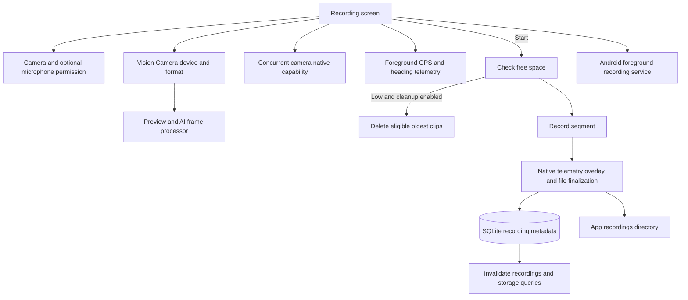

**Source references:** [`RecordingScreen.tsx`](../src/screens/RecordingScreen.tsx), [`DetectionOverlay.tsx`](../src/components/DetectionOverlay.tsx), [`useVehicleDetector.ts`](../src/features/ai/useVehicleDetector.ts), [`recordingStore.ts`](../src/features/recording/recordingStore.ts), [`settingsStore.ts`](../src/features/recording/settingsStore.ts), [`cameraCapabilities.ts`](../src/features/recording/cameraCapabilities.ts), [`cameraTelemetryNative.ts`](../src/features/recording/cameraTelemetryNative.ts), [`recordingForegroundService.ts`](../src/features/recording/recordingForegroundService.ts), [`recordingFileService.ts`](../src/features/storage/recordingFileService.ts), [`database.ts`](../src/data/database.ts).

## 3. Video library — Videos

**Screen name and file:** Library (Videos tab), [`LibraryScreen.tsx`](../src/screens/LibraryScreen.tsx).

**Purpose and layout:** Lists local recordings with inline previews and extensive playback controls. Each recording card contains a preview/player, name/date/camera/resolution/frame-rate/file-size metadata, protected-or-upload-status badge, share/export and rename buttons, and optionally a fullscreen player modal. Separate modals handle rename, custom playback speed, timestamp jump, and resume confirmation.

**Inputs and validation:**
- Clip name: `TextInput` capped at 120 characters. Save is disabled for blank trimmed text or while saving. The database trims and rejects empty names, names over 120 characters, and ASCII control characters (0–31 and 127); accepted names are 1–120 printable characters.
- Custom speed: decimal input; applied only if finite and in the range 0.25–3 inclusive. Invalid input leaves the dialog open; no inline validation message is shown.
- Jump timestamp: accepts colon-separated numeric nonnegative parts in `ss`, `mm:ss`, or `hh:mm:ss` forms. Invalid/non-finite/negative parts do nothing. Parsed time is bounded to the clip duration by `seekTo`.

**Buttons and interactions:** Tap a clip preview to play; controls toggle on tap, and a rapid double tap seeks backward/forward 10 seconds on the left/right 40% or toggles playback in the center. The overlay supports play/pause, timeline seek, variable seek interval (5/10/15 seconds), frame step (1/30 second), previous/next clip, mute, volume, standard speed cycle (0.25× through 3×) and custom speed (long-press), audio-track cycling when multiple tracks exist, repeat off/one/all, shuffle, fullscreen, lock/unlock controls, stats, A/B loop points, bookmarks, timestamp jump, close, and saved-position resume/start-over. Playback progress is persisted at roughly 3-second intervals and on close/blur. Share opens the system share sheet. Rename opens a modal and updates SQLite.

**API calls and request/response handling:** `useQuery(['recordings'], listRecordings)` loads the local SQLite list. `useMutation(renameRecording)` writes the new name and invalidates the query on success. Playback uses `react-native-video` with local file URIs; load callbacks provide duration/audio tracks, progress updates player time, end invokes repeat/shuffle/next behavior, and errors are stored for the affected clip and shown in the preview area. `shareRecording` validates URI/file existence/nonzero file size then invokes `react-native-share`; errors are displayed inline. `AsyncStorage` reads/writes `playback-position:<recordingId>`; saved positions greater than 5 seconds prompt resume. Storage failures are logged with `console.warn`.

**State management:** Recordings/query and rename mutation use TanStack Query. Playback controls, current clip, duration/time, audio selection, volume/mute/rate, fullscreen, controls visibility/lock, repeat/shuffle, A/B loop, bookmarks, dialogs, resume prompt, and errors use component state. Playback position persistence is in AsyncStorage; bookmarks/loop points and most player settings are in-memory and reset for a newly selected clip.

**Navigation and parameters:** Videos tab has no parameters. Playback happens inline and via an in-screen fullscreen `Modal`; this component does not navigate to the separately declared VideoPlayback route.

**Loading, success, empty, and error states:** Activity indicator while loading; query error card; “No recordings yet” empty state. A missing file that still appears in the list produces a video-player error. Share and rename errors render inline. Rename success closes its dialog after query invalidation. The resume modal is shown only when a stored position exceeds five seconds. Dialog cancellation closes the relevant modal.

**Reusable components and related code:** `Screen`, `Card`, `Label`, `StatusBadge`; internal `IconButton`, `PlaybackOverlay`, `ValueSlider`, and `VideoIcon`; `listRecordings`, `renameRecording`, `shareRecording`, `formatDuration`, `formatRecordedAt`, `formatPlayerTime`, audio-track label helper, AsyncStorage, and `react-native-video`.

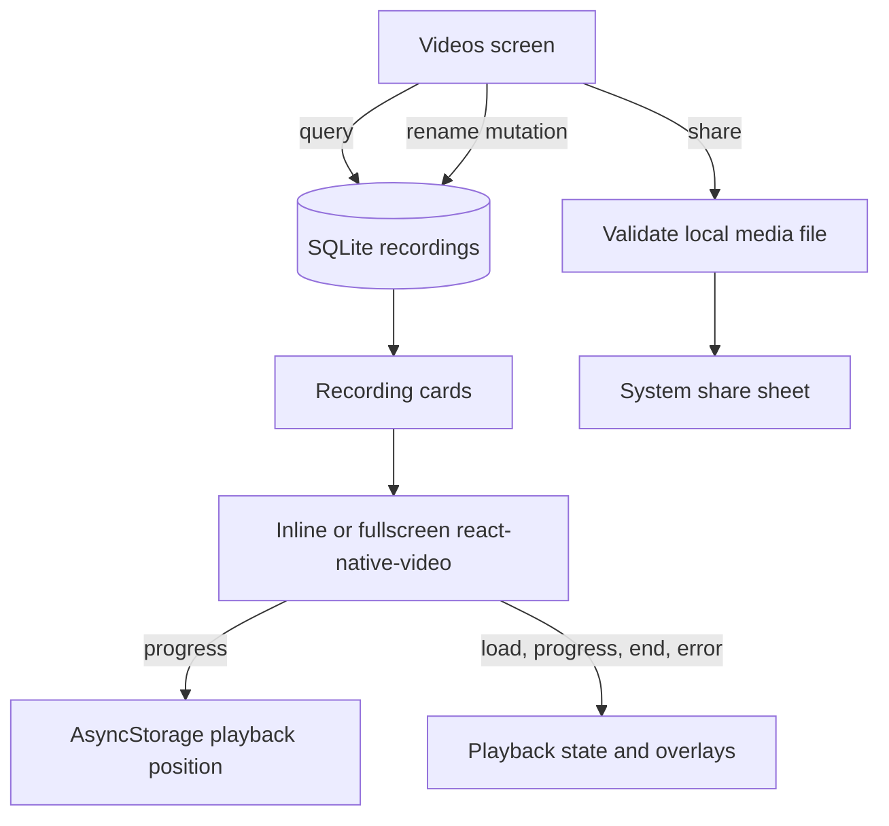

**Source references:** [`LibraryScreen.tsx`](../src/screens/LibraryScreen.tsx), [`database.ts`](../src/data/database.ts), [`shareRecording.ts`](../src/features/storage/shareRecording.ts), [`models.ts`](../src/data/models.ts), [`UI.tsx`](../src/components/UI.tsx), [`Screen.tsx`](../src/components/Screen.tsx).

## 4. Clip playback — VideoPlayback

**Screen name and file:** Playback, [`PlaybackScreen.tsx`](../src/screens/PlaybackScreen.tsx).

**Purpose and layout:** Loads a single local recording selected by route ID, displays a native video player and clip metadata, and offers share/export. Hierarchy: `Screen` → loading/error/clip-not-found state or video frame + optional playback error + metadata/share card.

**Inputs and validation:** No editable inputs. The route requires `recordingId: string`; the screen searches the fetched local recordings for an exact ID. No additional validation of the route string is performed.

**Buttons and interactions:** Native video controls handle playback. “Share / export clip” invokes the local media share helper. If no matching record exists the share handler is a no-op.

**API calls and request/response handling:** `useQuery(['recordings'], listRecordings)` loads SQLite metadata. `react-native-video` uses `recording.localUri`; native playback errors display the provided native error string or a fallback. `shareRecording` checks URI, file existence, file type and nonzero size before opening the platform share sheet; rejected promises become an inline error.

**State management:** Query state is managed by TanStack Query. One local `playbackError` string stores video or share errors. No persistent player position or shared player state is used here.

**Navigation and parameters:** Stack route `VideoPlayback` takes `{recordingId: string}`. It has a default native-stack header titled “Clip” and back behavior. It is registered in `AppNavigator`, but there is currently no in-app `navigate('VideoPlayback', ...)` call; Videos uses its own inline player instead.

**Loading, success, empty, and error states:** Loading indicator; SQLite error card; if the ID is absent, a warning says the clip may have been removed. Successful matching data renders video and metadata. Video/share errors are displayed in a danger card. No separate success message is shown.

**Reusable components and related code:** `Screen`, `Card`, `ActionButton`, `Label`; `listRecordings`, `shareRecording`; `react-native-video`; `RootStackParamList`.

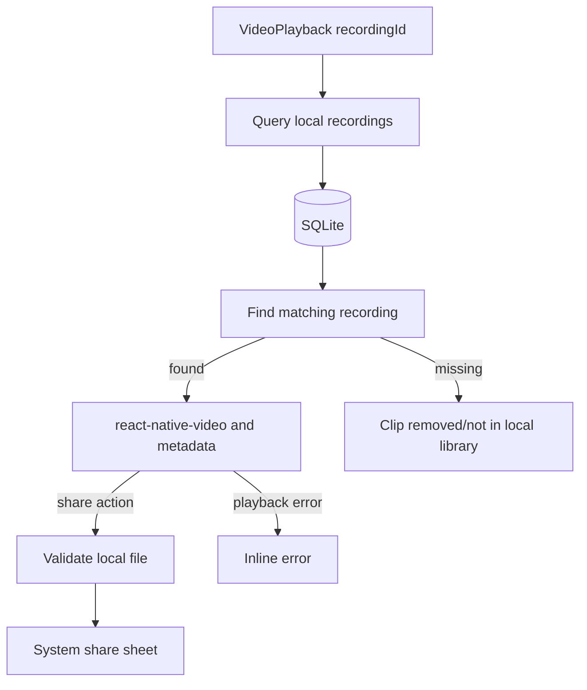

**Source references:** [`PlaybackScreen.tsx`](../src/screens/PlaybackScreen.tsx), [`AppNavigator.tsx`](../src/navigation/AppNavigator.tsx), [`types.ts`](../src/navigation/types.ts), [`database.ts`](../src/data/database.ts), [`shareRecording.ts`](../src/features/storage/shareRecording.ts).

## 5. Trips — Trips

**Screen name and file:** Trips, [`TripsScreen.tsx`](../src/screens/TripsScreen.tsx).

**Purpose and layout:** Starts/stops foreground-only GPS trip tracking and displays a local trip history. The screen contains an active-status card (live coordinates/accuracy, speed, end/start control, errors), location disclaimer card, trip-history heading, and history loading/error/list/empty state.

**Inputs and validation:** No text inputs. On a GPS update, accuracy must be finite and between 0 and 100 m; latitude/longitude must be finite and in geographic ranges; timestamp must be finite. Points outside these constraints are ignored. Provider speed is accepted only when finite, 0–55 m/s, and accuracy ≤30 m; otherwise `estimateSpeedMps` may derive speed from successive points, requiring accuracy ≤20 m, elapsed time 1–30 seconds, movement beyond reported accuracy, and speed ≤55 m/s. Distance increment uses reliable points (accuracy ≤50 m, elapsed interval >0 and ≤120 seconds, movement beyond combined accuracies, and plausible speed/distance bound).

**Buttons and interactions:** “Start trip tracking” requests foreground location permission, creates a SQLite trip, updates the trip store, and starts a location watch. The button is disabled and changes to “Starting trip…” during startup. “End trip” clears the watch, marks the trip ended, and refreshes history. A location error, leaving the foreground, or unmounting the Trips screen also ends tracking.

**API calls and request/response handling:** `useQuery(['trips'], listTrips)` loads SQLite trip history. `requestForegroundLocationPermission` asks iOS location authorization or Android fine/coarse permission. `createTrip` inserts a trip, each accepted `Geolocation.watchPosition` result creates a `TripPoint` and calls `saveTripPoint` (point insert and accumulated distance update are in one SQLite transaction), and `finishTrip` sets `ended_at`. Query invalidation follows point saves and normal trip stop. Permission denial and location/database failures set the trip store error; a point-save failure stops the active trip. AppState transitions out of `active` stop tracking.

**State management:** `useTripStore` owns tracking flag, trip ID, current point, and error. The screen uses refs to prevent duplicate starts and keep the watch ID/AppState. `isStarting` is local state. Trip history is TanStack Query state.

**Navigation and parameters:** Trips tab; no parameters and no explicit navigation actions.

**Loading, success, empty, and error states:** While active but before first valid point, shows “Waiting for an accurate GPS fix…” and speed unavailable. Active location shows lat/long and accuracy plus speed when available. Start status is shown on the button. History has loading text, error text, a localized start/end time and distance list, or “No trips recorded.” Permission, tracking, finalization, and save errors appear in the active card. The description states trip data is foreground-only.

**Reusable components and related code:** `Screen`, `Card`, `ActionButton`, `Label`, `StatusBadge`; `useTripStore`, `listTrips`, `createTrip`, `saveTripPoint`, `finishTrip`, `requestForegroundLocationPermission`, `estimateSpeedMps`, and `distanceBetweenReliablePoints`.

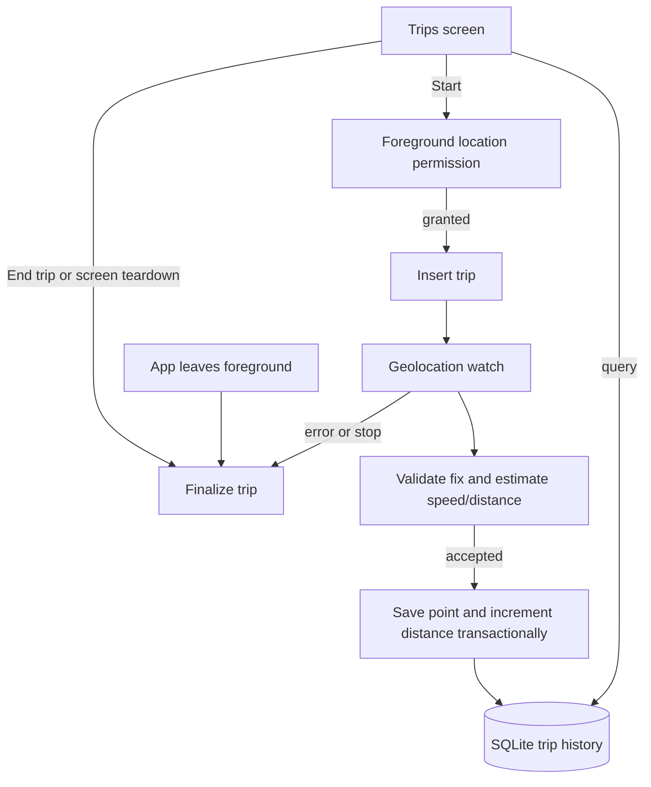

**Source references:** [`TripsScreen.tsx`](../src/screens/TripsScreen.tsx), [`tripStore.ts`](../src/features/trips/tripStore.ts), [`locationPermissions.ts`](../src/features/trips/locationPermissions.ts), [`gpsPolicy.ts`](../src/features/trips/gpsPolicy.ts), [`database.ts`](../src/data/database.ts), [`models.ts`](../src/data/models.ts).

## 6. Storage manager — StorageManager

**Screen name and file:** Storage, [`StorageScreen.tsx`](../src/screens/StorageScreen.tsx).

**Purpose and layout:** Reports device storage, toggles automatic low-space cleanup, and lists clips with protection status, upload status, protection toggle, and delete action. Hierarchy: `Screen` → storage/cleanup card → loading/error/list of clip cards → mutation error → explanatory cleanup note.

**Inputs and validation:** No text fields. Automatic cleanup is a boolean setting. Protect/unprotect and delete use recording IDs. Delete is disabled for protected clips and requires a native confirmation alert; the file service also rejects protected clips and queued/uploading clips, reserves deletion in SQLite, checks file existence, removes the file, and then removes metadata. Protection changes are rejected if the record is missing or deletion is reserved.

**Buttons and interactions:** Enable/disable automatic cleanup toggles the persisted setting. Protect/Unlock calls a mutation and disables all protection buttons while pending. Delete asks for confirmation; Cancel dismisses, Delete calls `deleteLocalRecording`. Successful delete invalidates recording and storage queries. Deleting a protected item is disabled in the view.

**API calls and request/response handling:** `useQuery(['storage'], RNFS.getFSInfo)` reads free/total bytes. `useQuery(['recordings'], listRecordings)` reads SQLite. `useMutation(setRecordingProtected)` updates the metadata and invalidates `['recordings']` on success. Delete uses filesystem and SQLite services and invalidates both queries; failures are shown in `Alert.alert`. Protection mutation errors render inline. No remote API is called.

**State management:** The automatic cleanup flag is in `useSettingsStore` (persisted in AsyncStorage). Queries and mutation state use TanStack Query. Clip protection/upload status comes from SQLite. No local text/form state.

**Navigation and parameters:** Stack route `StorageManager`, no parameters. Reached from the Settings tab’s “Storage manager” row; native-stack header title is “Storage”.

**Loading, success, empty, and error states:** Storage and recordings display independent loading indicators and errors. The source does not render a dedicated empty-state message when the recordings list is empty. Success is reflected by refreshed data; no toast. Delete errors use a native alert. Protection errors appear below the list.

**Implementation note:** The bottom text says “Loop cleanup is not enabled” unconditionally, even when the persisted toggle is enabled. The actual cleanup flag is still read by RecordingScreen and used before recording; the storage note does not reflect that state.

**Reusable components and related code:** `Screen`, `Card`, `ActionButton`, `Label`, `StatusBadge`; `useSettingsStore`, `listRecordings`, `setRecordingProtected`, `deleteLocalRecording`, `formatBytes`, `RNFS.getFSInfo`, and `Alert`.

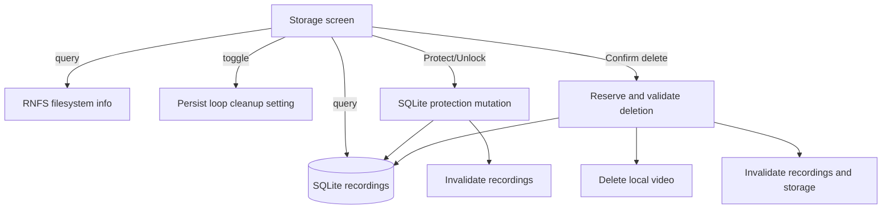

**Source references:** [`StorageScreen.tsx`](../src/screens/StorageScreen.tsx), [`recordingFileService.ts`](../src/features/storage/recordingFileService.ts), [`settingsStore.ts`](../src/features/recording/settingsStore.ts), [`database.ts`](../src/data/database.ts), [`cleanupPolicy.ts`](../src/features/storage/cleanupPolicy.ts).

## 7. Settings — Settings

**Screen name and file:** Settings, [`SettingsScreen.tsx`](../src/screens/SettingsScreen.tsx).

**Purpose and layout:** Navigation hub, not a settings form. `Screen` heading/subtitle wraps one card containing five `Row` controls for camera/recording, storage manager, cloud backups, privacy/permissions, and diagnostics.

**Inputs and validation:** No input fields or validation.

**Buttons and interactions:** Tapping a row navigates to its corresponding stack screen: CameraSettings, StorageManager, CloudProviders, PrivacySettings, or Diagnostics.

**API calls and request/response handling:** None. No local query, mutation, or remote request.

**State management:** No component or global state read/write.

**Navigation and parameters:** Settings tab, no parameters. The rows navigate to the named stack routes; all destination routes currently take no parameters.

**Loading, success, empty, and error states:** Static content only; no loading, success, empty, or error state.

**Reusable components and related code:** `Screen`, `Card`, `Row`, `AppTabNavigationProp`; route types and `AppNavigator`.

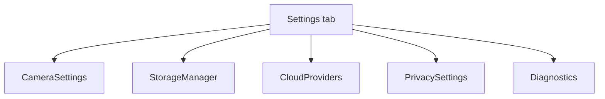

**Source references:** [`SettingsScreen.tsx`](../src/screens/SettingsScreen.tsx), [`AppNavigator.tsx`](../src/navigation/AppNavigator.tsx), [`types.ts`](../src/navigation/types.ts), [`UI.tsx`](../src/components/UI.tsx).

## 8. Privacy & permissions — PrivacySettings

**Screen name and file:** Privacy settings, [`PrivacySettingsScreen.tsx`](../src/screens/PrivacySettingsScreen.tsx).

**Purpose and layout:** Read-only summary of camera, microphone, location, and network usage plus a platform/lifecycle disclaimer. Two cards: four status rows and a text explanation.

**Inputs and validation:** No inputs or validation.

**Buttons and interactions:** None; rows are non-interactive.

**API calls and request/response handling:** No permission request is initiated here. It reads `audioEnabled` from recording settings and `isTracking` from the trip store; it does not query system permission status. No remote API.

**State management:** Read-only Zustand selectors; no local state.

**Navigation and parameters:** Stack route `PrivacySettings`, no parameters; reached from Settings.

**Loading, success, empty, and error states:** Static display with values conditional on audio setting and current trip tracking. No loading/error UI.

**Implementation note:** The text describes current settings/store values rather than actual OS permission grants. Location tracking is implemented in Trips, although permission is requested only when that feature starts. The lifecycle copy says this build stops recording when leaving the foreground.

**Reusable components and related code:** `Screen`, `Card`, `Label`, `Row`, `useSettingsStore`, and `useTripStore`.

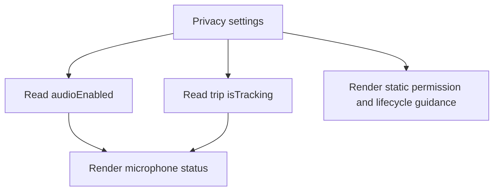

**Source references:** [`PrivacySettingsScreen.tsx`](../src/screens/PrivacySettingsScreen.tsx), [`settingsStore.ts`](../src/features/recording/settingsStore.ts), [`tripStore.ts`](../src/features/trips/tripStore.ts), [`TripsScreen.tsx`](../src/screens/TripsScreen.tsx).

## 9. Diagnostics — Diagnostics

**Screen name and file:** Diagnostics, [`DiagnosticsScreen.tsx`](../src/screens/DiagnosticsScreen.tsx).

**Purpose and layout:** Static support disclaimer and declared capability/status rows. Two cards: warning badge and platform/camera/resolution/simultaneous-camera/locked-recording/location/cloud rows, then device-testing guidance.

**Inputs and validation:** None.

**Buttons and interactions:** None; all rows are read-only.

**API calls and request/response handling:** None. It reads `Platform.OS` only; no runtime camera, storage, location, or cloud query is performed.

**State management:** No React or global state.

**Navigation and parameters:** Stack route `Diagnostics`, no parameters; reached from Settings.

**Loading, success, empty, and error states:** Always renders the static “DEVICE TEST NOT YET RECORDED” warning and explanatory copy. There is no loading/error state or saved test result.

**Implementation note:** These labels are static and not authoritative capability detection. In particular, the row “Front + rear simultaneously: Not implemented” is inconsistent with RecordingScreen, which offers dual recording when concurrent camera support is returned. “Location / trip tracking: Off and not implemented” is also static; TripsScreen implements foreground trip tracking. No diagnostic test is actually recorded by this screen.

**Reusable components and related code:** `Screen`, `Card`, `Label`, `Row`, `StatusBadge`, React Native `Platform`.

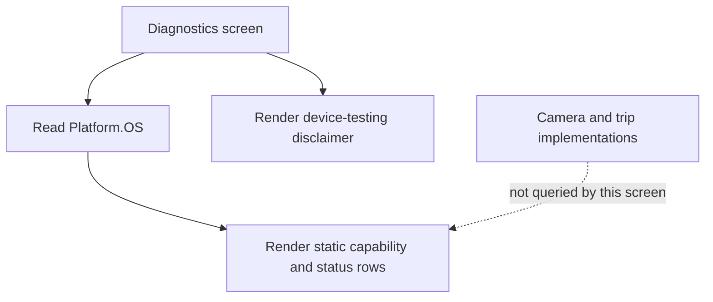

**Source references:** [`DiagnosticsScreen.tsx`](../src/screens/DiagnosticsScreen.tsx), [`RecordingScreen.tsx`](../src/screens/RecordingScreen.tsx), [`TripsScreen.tsx`](../src/screens/TripsScreen.tsx), [`AppNavigator.tsx`](../src/navigation/AppNavigator.tsx).

## 10. Backups — CloudProviders

**Screen name and file:** Cloud providers, [`CloudProvidersScreen.tsx`](../src/screens/CloudProvidersScreen.tsx).

**Purpose and layout:** Static informational page listing Google Drive, Microsoft OneDrive, Dropbox, and USB / Files as disconnected providers. A top status card says no providers are connected; four provider cards say “Not connected”; final copy explains a transfer must be verified before an original is eligible for deletion.

**Inputs and validation:** None.

**Buttons and interactions:** None. Provider cards are not connect buttons.

**API calls and request/response handling:** None. This screen does not authenticate, access credentials, enqueue uploads, or make network requests. There is no response handling.

**State management:** No local or global state.

**Navigation and parameters:** Stack route `CloudProviders`, no parameters; reached from Settings.

**Loading, success, empty, and error states:** Static “NO PROVIDERS CONNECTED” and “Not connected” states; no loading/error/connected-provider state is implemented.

**Reusable components and related code:** `Screen`, `Card`, `Label`, `StatusBadge`; local provider-name array.

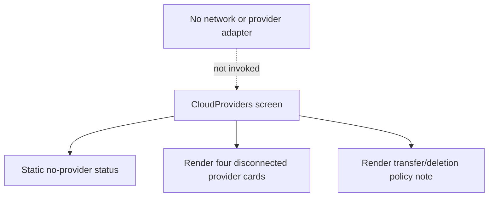

**Source references:** [`CloudProvidersScreen.tsx`](../src/screens/CloudProvidersScreen.tsx), [`AppNavigator.tsx`](../src/navigation/AppNavigator.tsx).

## 11. Camera & recording settings — CameraSettings

**Screen name and file:** Camera settings, [`CameraSettingsScreen.tsx`](../src/screens/CameraSettingsScreen.tsx).

**Purpose and layout:** Configures selected camera, supported resolution, quality preset, frame rate, codec, custom bitrate, segment length, microphone audio, and displays bitrate/storage estimates. Cards are ordered as selected camera, camera settings, storage estimate, optional active-recording warning, microphone, and segment length.

**Inputs and validation:**
- Camera: front/rear choice buttons. Disabled until persisted settings hydrate and while recording/finalizing; selected device is later checked on Recording.
- Resolution and frame rate: choices are filtered from reported camera formats; settings are disabled until hydration/device availability and while recording.
- Quality: Low/Medium/High; no separate user-input validation.
- Codec: H.264/H.265 choices are filtered by native encoder capability for selected dimensions/frame rate. If the stored codec is unsupported it is reset to H.264 when available, otherwise the first reported codec. On capability-check failure the screen falls back to offering H.264 and warns.
- Custom bitrate: decimal-pad field; blank clears the override; otherwise only finite 0.5–100 Mbps values are persisted. Invalid values remain in the text field, show an error, and do not replace the last valid stored setting.
- Segment length: 1, 5, or 10 minutes; buttons are disabled while recording/finalizing.
- Audio toggle: enabled/disabled in settings but cannot be changed while recording/finalizing. Microphone permission is requested later on recording start, not from this screen.

**Buttons and interactions:** Camera, resolution, quality, frame-rate, codec, audio, and segment choices update `useSettingsStore`. The screen automatically falls back to a supported resolution/frame rate when the currently selected configuration is unsupported (only after hydration and when not recording). On focus it checks filesystem free space. It checks codecs when a selected format is available.

**API calls and request/response handling:** `hydrateSettingsStore()` rehydrates persisted settings from AsyncStorage and reports failure inline. `useCameraDevice` supplies formats. `getRecordingConfiguration`, `getSupportedResolutions`, `getSupportedFrameRates`, and `selectRecordingFormat` derive valid runtime configurations. `getSupportedVideoCodecs(width,height,frameRate)` calls the platform native module; loading/error/no-codec states render explanatory copy. `RNFS.getFSInfo()` reads free space when focused; failure renders a warning. Bitrate and per-minute/per-segment size estimates are calculated locally; they are estimates, not a server response.

**State management:** Camera/audio/segment/cleanup/video settings persist through Zustand `persist` to AsyncStorage. UI-only state includes hydration/error flags, codec list/loading/error, storage result/error, custom bitrate text and validation error. Recording/finalizing status is read from `useRecordingStore`.

**Navigation and parameters:** Stack route `CameraSettings`, no parameters; reached from Settings. Native-stack header title is “Camera”.

**Loading, success, empty, and error states:** Hydration error appears in a card; until ready/device is known, controls are disabled and supported format text can say it is waiting. Empty resolution/frame-rate/codec capabilities have explanatory labels. Codec and storage checks show loading/warning/error messages. Storage estimate may warn when available free space is below 512 MB reserve plus estimated segment size. Active recording shows a warning that changes apply to the next recording; configuration controls are disabled.

**Reusable components and related code:** `Screen`, `Card`, `ActionButton`, `Label`, `Row`; internal generic `ChoiceGroup`; `useSettingsStore`, `hydrateSettingsStore`, `useRecordingStore`, Vision Camera `useCameraDevice`, `cameraCapabilities`, `videoSettings`, `formatBytes`, and `RNFS`.

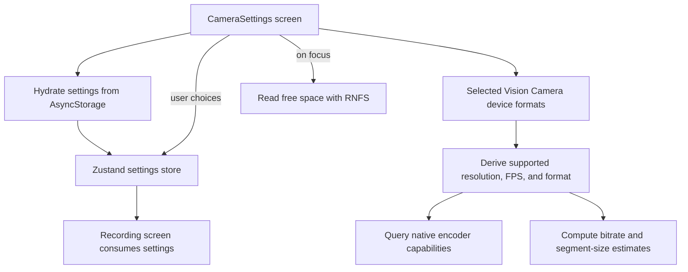

**Source references:** [`CameraSettingsScreen.tsx`](../src/screens/CameraSettingsScreen.tsx), [`settingsStore.ts`](../src/features/recording/settingsStore.ts), [`recordingStore.ts`](../src/features/recording/recordingStore.ts), [`videoSettings.ts`](../src/features/recording/videoSettings.ts), [`cameraCapabilities.ts`](../src/features/recording/cameraCapabilities.ts), [`formatBytes.ts`](../src/features/storage/formatBytes.ts), [`RecordingScreen.tsx`](../src/screens/RecordingScreen.tsx).
